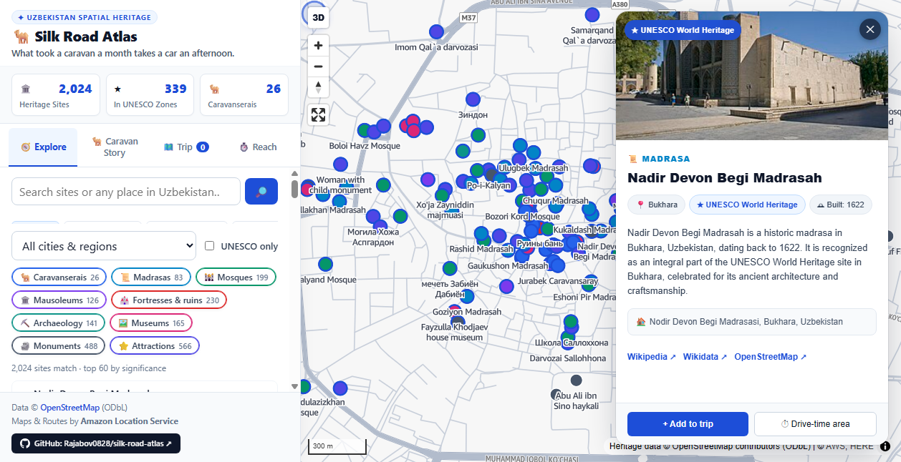
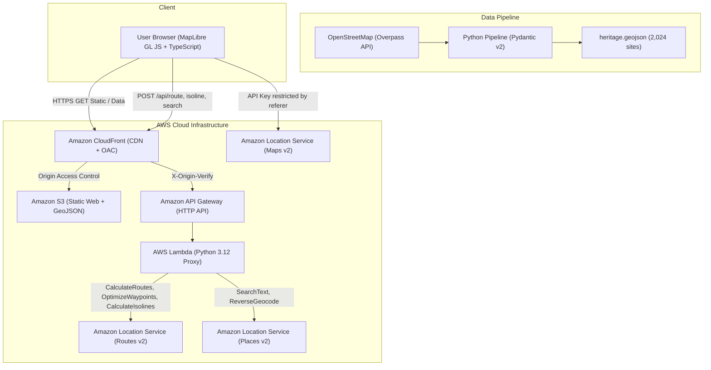

# 🐫 Silk Road Atlas: Uzbekistan Heritage & Caravan Journey Explorer

> **Live Application**: [https://d3fx98y0gpu4w7.cloudfront.net](https://d3fx98y0gpu4w7.cloudfront.net)  
> **AWS Location Services Hackathon Project**  
> *"What took a Silk Road camel caravan a month takes a modern car an afternoon."*



Silk Road Atlas puts **2,024 historical and cultural heritage sites** across Uzbekistan on an interactive, explorable map powered by **Amazon Location Service**, **AWS Lambda**, **Amazon CloudFront**, and **Amazon S3**.

---

## 🗺️ What Makes It Unique: The Four Criteria

### 1. Technical Innovation & Originality (25%)
- **Multi-Capability Amazon Location Service Integration**:
  - **Routes v2 (`CalculateRoutes`)**: Real-time road routing over ancient trade corridors. Computes actual highway geometry, distance, and driving duration.
  - **Routes v2 (`OptimizeWaypoints`)**: Algorithmic itinerary optimizer that solves the Traveling Salesperson Problem for custom tourist routes while preserving start/end points.
  - **Routes v2 (`CalculateIsolines`)**: Computes 15-, 30-, and 60-minute driving isochrones (reachability polygons) from any clicked point in Uzbekistan.
  - **Places v2 (`SearchText` & `ReverseGeocode`)**: Bounding-box-constrained search across Uzbekistan and real-time reverse geocoding for historical monuments.
  - **Maps v2**: High-performance vector tile rendering with MapLibre GL JS and custom Silk Road light palette.
- **Cinematic 3D Flyover**: One-click 3D camera toggle (55° tilt pitch & dynamic bearing) for cinematic aerial flyovers over ancient Silk Road oases.
- **Secure Serverless Architecture**:
  - Browsers never receive raw AWS credentials. API requests are securely proxied through an **AWS Lambda (Python 3.12 + Pydantic v2)** microservice via **Amazon API Gateway HTTP API**.
  - Maps API Key is locked to `geo-maps:*` only and restricted by domain referrers.
  - Static assets and dataset are served from **Amazon S3** via **Amazon CloudFront** using **Origin Access Control (OAC)** and strict security headers.

### 2. Craft & Execution (25%)
- **Strict Data Pipeline**: Built with Python and Pydantic v2 to sanitize, deduplicate, and validate Overpass API OpenStreetMap data. Non-HTTPS links are scrubbed; coordinates are strictly bounded to Uzbekistan; UNESCO World Heritage sites are indexed spatially.
- **Modern, Accessible UI**:
  - Zero framework bloat: Vite + TypeScript + MapLibre GL JS with sub-second page loads.
  - No `innerHTML` usage anywhere to eliminate DOM-based XSS risks.
  - Interactive category chips, instant quick filters, and deep-linkable URLs (`#site=way/185036984`).
- **Floating Inspector Drawer & Live Photography**: Sleek non-clipping inspector card with high-resolution photography, Wikidata summaries, and Amazon Location reverse-geocoded addresses.
- **Comprehensive Automated Testing**:
  - 16 backend unit & integration tests covering routing, waypoint optimization, isolines, and validation error branches.
  - 10 frontend unit tests verifying distance formatting, caravan calculations, along-route spatial filters, and point-in-polygon checks.
  - 9 data pipeline tests verifying classification and deduplication.

### 3. Usefulness & Impact (25%)
- **Real-World Cultural Preservation & Tourism**:
  - Highlights neglected historical monuments, roadside caravanserais (*rabats*), and madrasas that generic tourist maps omit.
  - Identifies 339 monuments within 4 UNESCO World Heritage zones: *Historic Centre of Bukhara*, *Samarkand – Crossroad of Cultures*, *Itchan Kala (Khiva)*, and *Historic Centre of Shakhrisyabz*.
- **Practical Trip Planning & GPX Export**:
  - Travelers can select monuments, click "Route my trip", and get an optimized itinerary with drive times, total kilometers, and turn-by-turn road paths.
  - Export custom itineraries directly to **GPX** for handheld GPS devices (Garmin, OsmAnd) or open with 1-click in **Google Maps**.
- **Along-Route Heritage Discovery**:
  - Automatically discovers caravanserais and historic ruins situated within 10 km of the computed driving corridor.
- **Accessibility & "Reach" Analysis**:
  - Arriving at a train station or hotel? Click "Pick a starting point" to instantly see how many monuments are reachable within 15, 30, or 60 minutes.

### 4. Creativity & Storytelling (25%)
- **Caravan Story Mode**:
  - Takes users on a guided historical journey across Uzbekistan: **Margilan (Fergana Silk) → Kokand → Tashkent → Samarkand → Shahrisabz → Bukhara → Khiva**.
  - Curated high-resolution photography and historical era context for each stop.
  - **Caravan Maths**: Calculates travel time for a traditional camel caravan covering 30 km/day versus a modern automobile on M37/A380 highways.
  - *Example*: Samarkand to Bukhara (273 km) took a loaded 14th-century caravan **9 full days** of desert travel; today, Amazon Location Routes shows it takes **3 hours and 33 minutes by car** (a **60× speedup**).

---

## 🏛️ Dataset Overview

- **Source**: [OpenStreetMap](https://www.openstreetmap.org/) contributors via Overpass API.
- **License**: Open Database License (ODbL 1.0).
- **Size**: **2,024 cleaned heritage sites** across Uzbekistan.
- **Breakdown by Category**:
  - Attractions & historic buildings: 566
  - Monuments & memorials: 488
  - Fortresses, city walls & castles: 230
  - Mosques: 199
  - Museums: 165
  - Archaeological sites: 141
  - Mausoleums: 126
  - Madrasas: 83
  - Caravanserais (*rabats*): 26
- **UNESCO World Heritage Sites**:
  - Historic Centre of Bukhara: 120 monuments
  - Samarkand – Crossroad of Cultures: 105 monuments
  - Itchan Kala (Khiva): 96 monuments
  - Historic Centre of Shakhrisyabz: 18 monuments

---

## 🏗️ Architecture



---

## 🚀 Getting Started

### Prerequisites
- Node.js 20+ and npm
- Python 3.11+
- AWS CLI configured (`aws configure`)

### 1. Local Development
```bash
# Clone the repository
git clone <repo-url>
cd silk-road-atlas

# Create virtual environment and install dependencies
python -m venv .venv
.\.venv\Scripts\activate
pip install -r backend/requirements.txt -r data-pipeline/requirements.txt
cd web && npm install && cd ..

# Run both local servers with live AWS Location calls
python scripts/dev.py
```
Open [http://localhost:5173](http://localhost:5173) in your browser.

### 2. Running Automated Tests
```bash
# Backend unit & integration tests (16 tests)
cd backend && pytest -v

# Frontend unit tests (10 tests)
cd ../web && npm test

# Pipeline tests (9 tests)
cd ../data-pipeline && pytest -v
```

### 3. Deploying to AWS (S3 + CloudFront + Lambda + API Gateway)
```bash
python scripts/deploy.py
```

---

## 📜 License & Acknowledgments

- Map and heritage data © [OpenStreetMap contributors](https://www.openstreetmap.org/copyright) under ODbL 1.0.
- Routing, search, and map tile services provided by **Amazon Location Service**.
